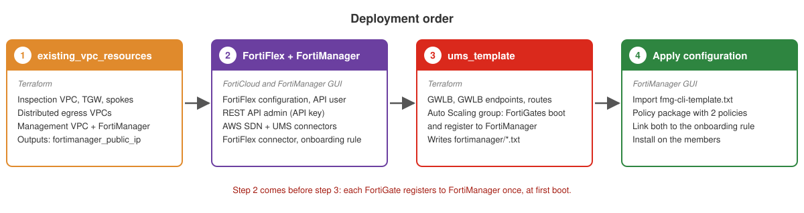

# Deployment



1. [existing_vpc_resources](5_1_existing_vpc_resources/): lab VPCs, Transit Gateway, distributed egress VPCs, management VPC with FortiManager
2. Configure FortiFlex and FortiManager: [FortiManager Configuration](../4_fortimanager/)
3. [ums_template](5_2_ums_template/): the FortiGate UMS group behind the Gateway Load Balancer
4. [Apply Configuration](5_3_apply_configuration/): CLI template and policy package on the UMS group

Both templates read `cp` and `env`, and these must match: `ums_template` finds the VPCs, subnets and route tables by `Fortinet-Role` tags built from them.

```
terraform/
├── existing_vpc_resources/     # lab environment
│   ├── terraform.tfvars.example
│   └── tfvars.ui
└── ums_template/               # FortiGate UMS group
    ├── terraform.tfvars.example
    ├── tfvars.ui
    ├── fortimanager_templates/ # CLI template and policy reference, rendered at apply
    └── fortimanager/           # rendered output (created by terraform apply, not in Git)
```

`tfvars.ui` holds the same variables as `terraform.tfvars.example`, with `@ui-*` annotations for form-based tools.
